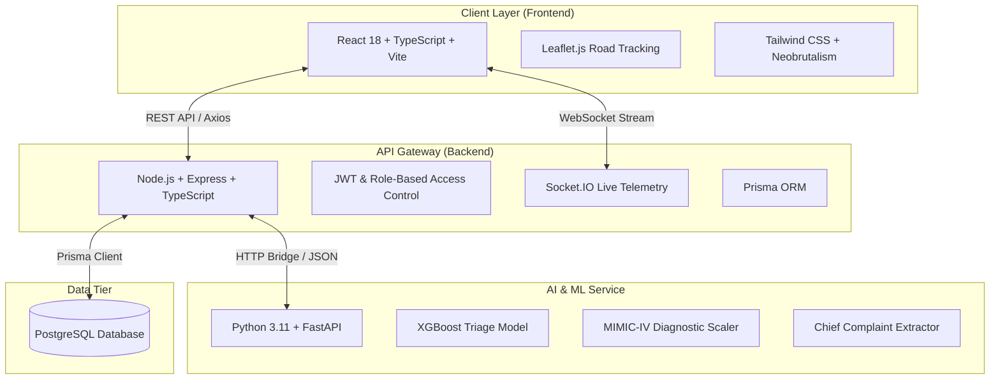

# 🏥 VIT-Health: AI-Powered Smart Campus Healthcare & Emergency Telemedicine Platform

[](https://react.dev/)
[](https://www.typescriptlang.org/)
[](https://nodejs.org/)
[](https://fastapi.tiangolo.com/)
[](https://xgboost.readthedocs.io/)
[](https://tailwindcss.com/)
[](https://www.prisma.io/)
[](https://socket.io/)

> **Academic Project Disclaimer:**  
> Developed as a Capstone / Project Exhibition Initiative at **Vellore Institute of Technology, Bhopal Campus**.  
> **Proposed for VTOP Integration:** An academic prototype demonstrating unified campus telemedicine, automated emergency ambulance dispatch, and AI epidemiological surveillance.

---

## 📌 Executive Summary

**VIT-Health** addresses the critical challenges of university campus healthcare: delayed medical dispatch to distant student hostels, absence of real-time outbreak surveillance, and long queues at the medical center. 

By unifying a **High-Precision Road Routing Ambulance Dispatcher**, **MIMIC-IV-trained XGBoost Clinical Triage Engine**, **Hostel-Level Epidemiological Surveillance**, and **Digital Clinic & Pharmacy Records**, VIT-Health provides a centralized, modern healthcare ecosystem proposed for VTOP integration.

---

## 🌟 Key Features & Modules

### 🚑 1. Smart Emergency Ambulance Dispatch & Tracking
- **Stationary Safe State**: Prevents false auto-dispatch; ambulance remains stationed at the campus clinic until explicitly called.
- **Hostel & Room Targeting**: Direct dispatch to **Boys Hostels** and **Girls Hostels** with mandatory room validation.
- **Campus Road Routing**: Visualizes actual vehicular pathways (OSRM road coordinates) instead of linear approximations.
- **Live Telemetry & Dynamic ETA**: Real-time progress updates, distance estimation, and arrival triggers.

### 🧠 2. AI Clinical Triage & Symptom Checker
- **MIMIC-IV Clinical ED Model**: Trained on emergency department patient triage datasets to calculate Emergency Severity Index (ESI Levels 1–5).
- **Dual Model Engine**: Combines **XGBoost** for severity categorization with **Multi-Layer Perceptron (MLP)** for diagnostic prediction.
- **Explainable AI (XAI)**: Key symptom feature importance and confidence metrics.

### 📊 3. Campus Outbreak Surveillance & Early Warning
- **Cluster Anomaly Detection**: Monitors symptom logs across individual hostel blocks to detect water-borne and viral spikes early.
- **Forecasting Engine**: Utilizes epidemiological trend analysis to forecast contagious case numbers for wardens and medical staff.
- **Preventative Health Alerts**: Broadcasts campus-wide preventive guidelines when cluster thresholds are exceeded.

### 🩺 4. Clinic Appointments & Tele-Consultation
- Real-time queue management for the campus health center.
- Doctor dashboard for reviewing student Electronic Medical Records (EMR).
- Instant digital prescription generation and slot reservation.

### 💊 5. Campus Pharmacy & Inventory Management
- Real-time stock tracking for vital OTC medications, first-aid essentials, and prescription drugs.
- Automated low-stock alerts and student medicine pickup status.

### 🧘 6. Confidential Student Mental Health Support
- Validated standardized assessments (PHQ-9 and GAD-7 scoring algorithms).
- Academic stress and sleep disruption correlation models.
- Private booking for campus counseling sessions.

---

## 🏗️ Architecture & Tech Stack



| Layer | Technologies |
| :--- | :--- |
| **Frontend** | React 18, TypeScript, Vite, Tailwind CSS, Lucide React, TanStack Query, Leaflet.js |
| **Backend** | Node.js, Express.js, TypeScript, Socket.IO, Prisma ORM, Zod, JWT |
| **AI / Machine Learning** | Python 3.11, FastAPI, XGBoost, Scikit-learn, Pandas, NumPy, Joblib |
| **Database** | PostgreSQL / SQLite (Development Seed supported via Prisma) |
| **DevOps & Tooling** | Docker, Docker Compose, Git Credential Manager |

---

## 📁 Repository Structure

```text
VIT-Health/
├── frontend/                   # React + Vite client application
│   ├── public/                 # Static assets and icons
│   ├── src/
│   │   ├── api/                # Axios endpoints (auth, emergency, doctor, symptoms)
│   │   ├── components/         # LiveAmbulanceMap, Modals, ProtectedRoute
│   │   ├── context/            # Authentication & State Providers
│   │   ├── pages/              # Ambulance, Triage, Doctor, Pharmacy, Auth dashboards
│   │   └── services/           # Campus road coordinate routing service
│   └── package.json
│
├── backend/                    # Express + TypeScript API server
│   ├── src/
│   │   ├── controllers/        # Request handlers for clinic, triage, and dispatch
│   │   ├── middleware/         # JWT verification, RBAC, error handlers
│   │   ├── routes/             # RESTful API route definitions
│   │   ├── services/           # Business logic, AI bridge, and notification dispatch
│   │   └── validators/         # Zod schemas for input validation
│   └── package.json
│
├── ai-service/                 # FastAPI ML Inference Engine
│   ├── app/
│   │   ├── models/             # Trained XGBoost & MIMIC-IV joblib/pickle binaries
│   │   ├── routers/            # Health intelligence & outbreak endpoints
│   │   ├── schemas/            # Pydantic request/response models
│   │   └── services/           # Severity classification & disease prediction
│   └── requirements.txt
│
├── database/                   # Database schemas & mock data
│   └── prisma/
│       ├── schema.prisma       # Prisma data model (Users, Hostels, Ambulances, EMR)
│       └── seed.ts             # Realistic campus outbreak & student mock seed
│
├── docs/                       # Architecture diagrams & API documentation
├── docker-compose.yml          # Container configuration for full ecosystem
└── package.json                # Monorepo workspaces definition
```

---

## 🚀 Quickstart & Local Installation

### Prerequisites
- **Node.js**: v18.0.0 or higher
- **npm**: v9.0.0 or higher
- **Python**: v3.10 or v3.11 (with `pip` and `virtualenv`)
- **Git**

---

### Step 1: Clone the Repository

```bash
git clone https://github.com/Devith01/VIT-Health.git
cd VIT-Health
```

---

### Step 2: Configure Environment Variables

Create `.env` files in `backend/` and `frontend/` using the provided templates:

```bash
# In backend/
cp backend/.env.example backend/.env

# In frontend/
cp frontend/.env.example frontend/.env
```

---

### Step 3: Install Dependencies

From the project root:

```bash
# Install backend and frontend monorepo dependencies
npm install

# Setup Python Virtual Environment for AI Service
cd ai-service
python -m venv venv

# Windows:
.\venv\Scripts\activate
# Linux/macOS:
source venv/bin/activate

pip install -r requirements.txt
cd ..
```

---

### Step 4: Initialize the Database

```bash
# Generate Prisma Client & Run Seeds
npm run db:generate
npm run db:migrate
npm run db:seed
```

---

### Step 5: Run the Ecosystem

Open three terminal tabs (or use the launcher scripts):

```bash
# Terminal 1: AI Engine (Port 8000)
cd ai-service
uvicorn app.main:app --reload --port 8000

# Terminal 2: Backend API (Port 5000)
npm run dev:backend

# Terminal 3: Frontend Client (Port 5173)
npm run dev:frontend
```

Visit **`http://localhost:5173`** in your browser.

---

## 🛡️ License & Academic Citation

This project is licensed under the **MIT License**.

If utilizing this codebase or prototype for academic exhibitions, please cite:
```bibtex
@misc{vithealth2026,
  author = {Devith},
  title = {VIT-Health: AI-Powered Smart Campus Telemedicine and Emergency Dispatch System},
  year = {2026},
  publisher = {GitHub},
  howpublished = {\url{https://github.com/Devith01/VIT-Health}}
}
```
